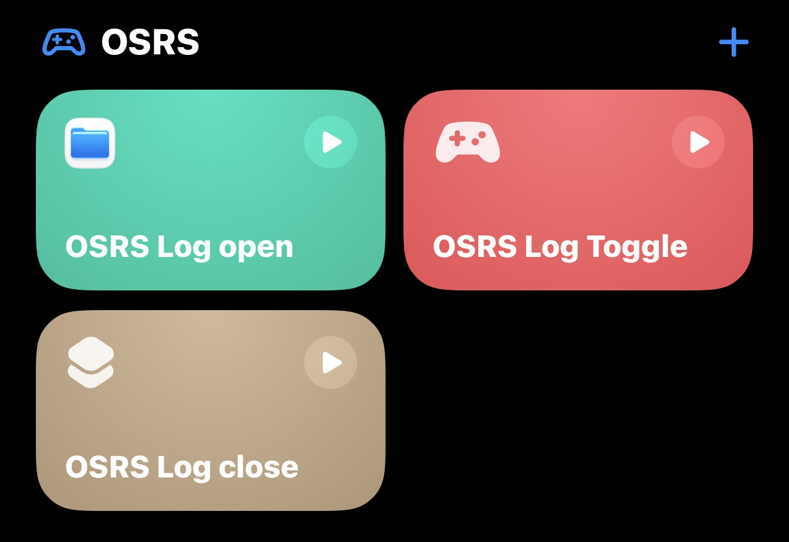
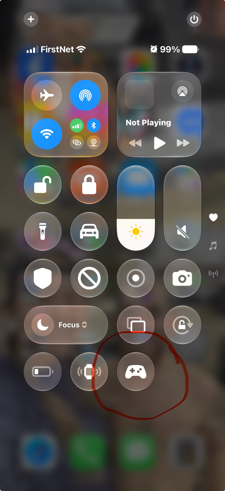
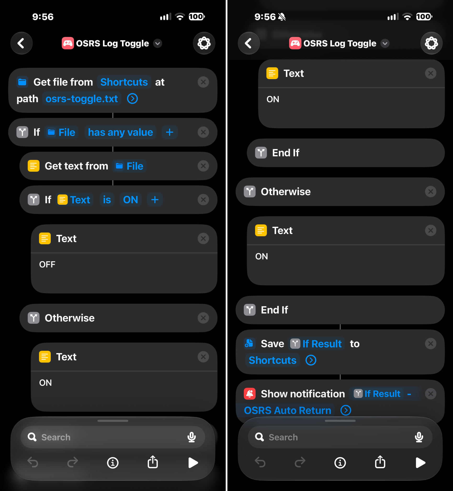
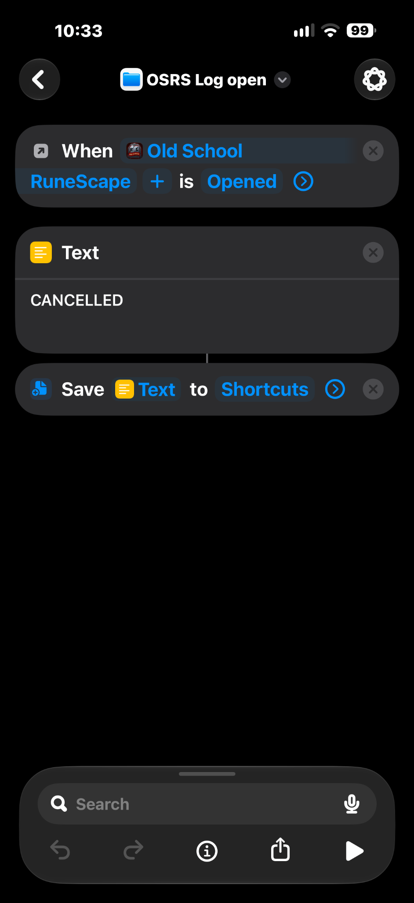
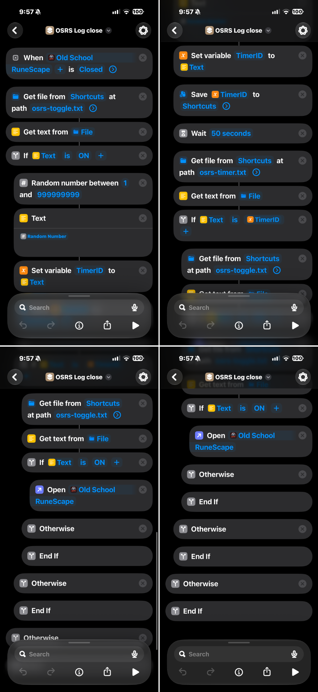

# OSRS iOS Auto Return

An Apple Shortcuts setup that brings Old School RuneScape Mobile back into the foreground after 50 seconds away from the app, intended to reduce iOS background disconnections.

## Install the shortcuts

Open each link on your iPhone and select Add Shortcut.

| Shortcut | Purpose | Installation |
| --- | --- | --- |
| OSRS Log Toggle | Enables or disables auto return | [Add Shortcut](https://www.icloud.com/shortcuts/3ca2d203c49c4db0a5aed3076bf4fb01) |
| OSRS Log open | Invalidates the previous countdown when OSRS opens | [Add Shortcut](https://www.icloud.com/shortcuts/26fcc0bd29b840ff823c749c6bcee55c) |
| OSRS Log close | Starts a 50-second countdown and conditionally reopens OSRS | [Add Shortcut](https://www.icloud.com/shortcuts/2c006c89b8b8479baa68026d6e6ecd5d) |

## Configure personal automations

Personal automation triggers must be configured on each device.

1. In Shortcuts, select **Automation**, then **+**.
2. Select **App**, choose **Old School RuneScape**, select **Is Opened** only, and choose **Run Immediately**.
3. Select the imported **OSRS Log open** shortcut (or add a Run Shortcut action pointing to it).
4. Create a second App automation for Old School RuneScape, this time selecting **Is Closed** only and **Run Immediately**.
5. Select **OSRS Log close** (or add a Run Shortcut action pointing to it).
6. Run **OSRS Log Toggle** to enable the feature. Allow any required file access prompts. Check the notification to confirm whether the feature is ON or OFF.
7. Optional: add **OSRS Log Toggle** to **Control Center** so you can switch the feature on or off with one tap.
8. Verify that the Save File actions overwrite the matching files in the same Shortcuts folder: `osrs-toggle.txt` for Toggle, and `osrs-timer.txt` for both Open and Close. In Toggle, the initial Get File action should not error if the file is missing.
9. Open OSRS, leave the app, and test whether it returns after approximately 50 seconds. Return manually before the countdown finishes, then leave again to test the timer reset.

To disable automatic return, run **OSRS Log Toggle** again and confirm OFF. You can also add the toggle to Control Center for quick access.

### Control Center toggle

The screenshot below shows the **OSRS Log Toggle** shortcut placed in Control Center for fast ON/OFF access.

## Shortcut previews

Click the download links below to install each shortcut.

### OSRS Log Toggle

**[⬇️ Download OSRS Log Toggle](https://www.icloud.com/shortcuts/3ca2d203c49c4db0a5aed3076bf4fb01)**

---

### OSRS Log open

**[⬇️ Download OSRS Log open](https://www.icloud.com/shortcuts/26fcc0bd29b840ff823c749c6bcee55c)**

---

### OSRS Log close

**[⬇️ Download OSRS Log close](https://www.icloud.com/shortcuts/2c006c89b8b8479baa68026d6e6ecd5d)**

---

## How it works

The toggle stores an ON/OFF state in `osrs-toggle.txt`. The close workflow creates a random timer ID, waits 50 seconds, checks that its ID still matches `osrs-timer.txt`, and checks that the toggle is still ON before opening OSRS. The open workflow saves the text `CANCELLED` to invalidate stale countdowns when the app is reopened. For this to work, its Save File action must target `osrs-timer.txt` with overwrite enabled. The screenshots do not expose the expanded Save File settings.

## Limitations and disclaimer

This setup is intended to address iOS background suspension, not the game's own inactivity timer. It does not simulate in-game taps or perform gameplay actions. iOS may interrupt shortcut execution, and behavior may vary by device and OS version. This project is not affiliated with or officially approved by Jagex. The permissibility of automatic app reopening has not been confirmed by Jagex; use at your own discretion. See the [OSRS rules](https://legal.jagex.com/docs/rules/rules-of-old-school-runescape) and [Jagex terms](https://legal.jagex.com/docs/terms/terms-and-conditions).
